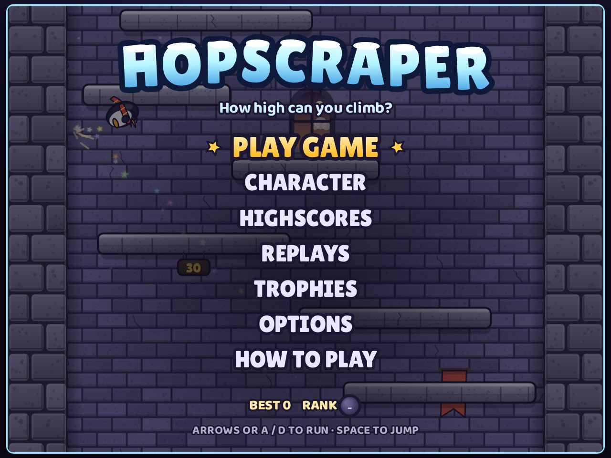
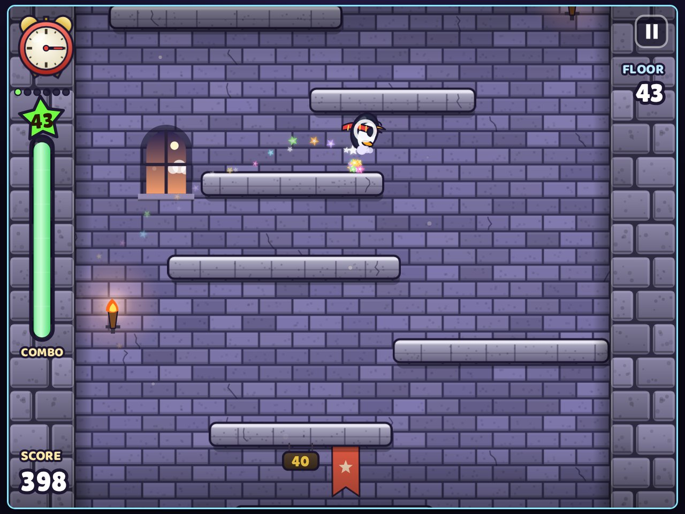
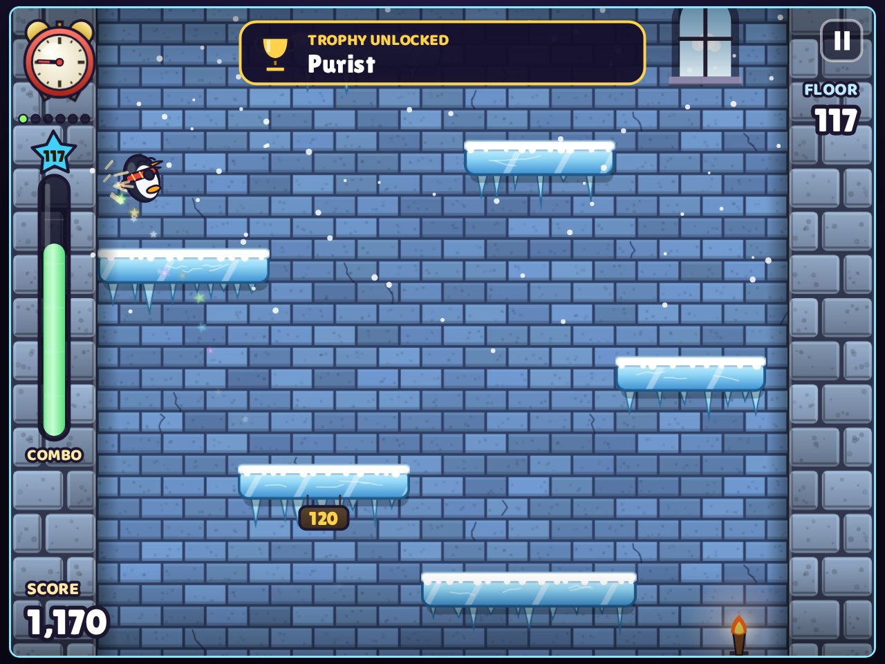
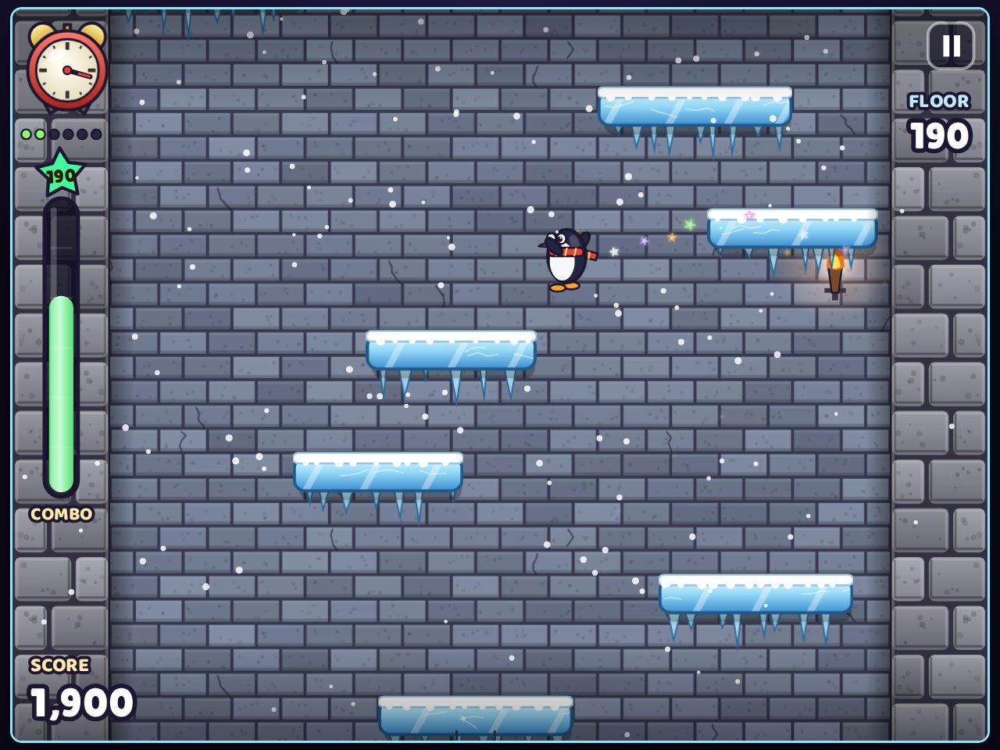
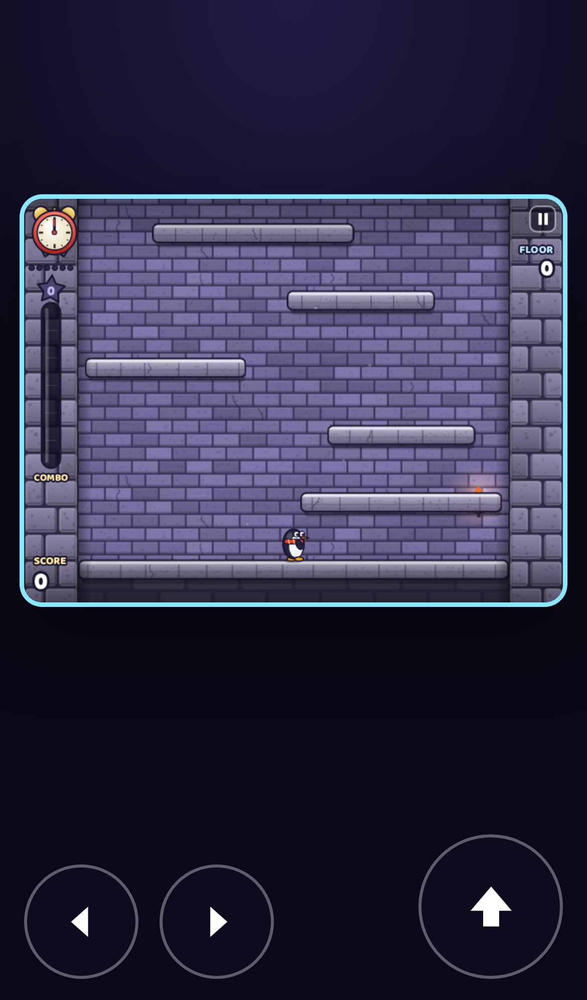

# Hopscraper

Sonsuz bir kuleye tırman. Koş, hızlan, duvardan sek ve katları atlayarak kombo zinciri kur. 5. kata çıkınca kule aşağı kaymaya başlar ve saat her turunu tamamladığında (30 sn) daha da hızlanır. Geride kalırsan oyun biter.

Tarayıcıda ve masaüstünde (macOS, Windows) çalışır. Oyun tek bir canvas üzerinde çiziliyor. Görsel dosya kullanılmıyor: karakterler, zeminler ve efektler kodla vektör olarak çiziliyor, sesler ve müzik Web Audio ile sentezleniyor. Bağımlılığı yok. Masaüstü sürümü aynı dosyaları Electron ile paketliyor.



| | |
|---|---|
|  |  |
|  |  |

## Oyun

- **Hareket.** Yerde hızlandıkça zıplama yükselir. Yeterince hızlıyken zıplarsan dönerek uçarsın. Havada duvara çarpınca aynı hızla geri seker.
- **Kombo.** Tek zıplayışta iki ya da daha fazla kat atlarsan kombo başlar. Süre dolmadan yeniden çok katlı zıplarsan kombo sürer. En az iki zıplayış ve 4 katla biten kombo, atlanan kat sayısının karesi kadar puan getirir (GOOD!, SWEET!, GREAT! … NO WAY!).
- **Kule.** Her 100 katta görünüm değişir: taş, buz, ahşap, çelik, şeker, kemik, orman, borular, bulutlar, gökkuşağı, yıldızlar. Katlar yükseldikçe daralır. Her 50 katta kenardan kenara bir kat vardır.
- **Karakterler.** 4 özgün karakter (Pip ve diğerleri), 19 kupa, yerel skor tablosu, istatistikler.
- **Tekrarlar.** Oyunun simülasyonu deterministik: her oyun bir tohum ve kare kare tuş girdilerinden ibaret. Tekrarlar bu yüzden birkaç KB tutuyor. İleri/geri sarılabiliyor, hızlandırılabiliyor, `HOPR1-…` kodu olarak paylaşılabiliyor.
- **Kontroller.** Klavye (tuşlar değiştirilebilir), oyun kolu, dokunmatik ekranda otomatik ekran tuşları. Dikey telefonda oyun alanı üstte, tuşlar altta.
- **Dil.** Türkçe ve İngilizce. Tarayıcı diline göre açılıyor, ayarlardan değişiyor.
- **Erişilebilirlik.** Hareketi azalt tercihine uyuluyor (ekran sarsıntısı kapanıyor), ses, müzik ve sesli anons ayrı ayrı ayarlanıyor.

Başlık ekranının arkasında oynayan karakteri, oyunun kendi fiziğini önceden hesaplayarak nereye ineceğini tahmin eden bir bot yönetiyor. Aynı bot testlerde de kullanılıyor.

## Çalıştırma

```bash
npm install
npm run serve         # tarayıcı: http://localhost:8080
npm start             # masaüstü penceresi (Electron)
npm test              # 6 test, gerçek tarayıcıda (Playwright)
npm run dist:mac      # release/ — Intel ve Apple Silicon zip
npm run dist:win      # release/ — Windows zip
npm run screenshots   # README görüntüleri
```

`web/` klasörü herhangi bir statik sunucuda olduğu gibi yayınlanabilir.

## Yapı

```
web/index.html   ekran, dokunmatik tuşlar, tekrar kodu penceresi
web/style.css    yerleşim (yatay / dikey / dokunmatik)
web/game.js      oyun: deterministik simülasyon, bot, tekrar kodlayıcı, kayıt,
                 ses sentezi, giriş, çizim, karakterler, arayüz, ekranlar
web/fonts/       Baloo 2 ve Lilita One (OFL)
main.js          Electron penceresi (F11 / Alt+Enter tam ekran)
test/            Playwright testleri
```

`game.js` bölümlere ayrılmış tek bir dosya. En üstteki simülasyon bölümü çizimden ve tarayıcıdan bağımsız. Aynı tohum ve aynı girdilerle her zaman aynı sonucu veriyor, tekrarlar da buna dayanıyor.

## Testler

`test/game.test.mjs` oyunu Chromium'da açıyor ve oyunun kendi fonksiyonlarını çağırıyor:

- Oyun hatasız açılıyor ve başlık ekranına geliyor.
- Aynı tohum aynı kuleyi ve aynı sonucu üretiyor, farklı tohum farklısını.
- Bot 6.000 karede en az 40. kata çıkıyor.
- Botun oyunu tekrar koduna çevrilip geri okununca birebir aynı skora ulaşıyor.
- Bozuk tekrar kodları reddediliyor.
- Telefonda oyun başlayınca üç dokunmatik tuş çıkıyor.

## Lisans

Kod MIT, Uğur Can Elsun. Baloo 2 ve Lilita One yazı tipleri SIL Open Font License 1.1 ile lisanslı (`web/fonts/*-OFL.txt`).
